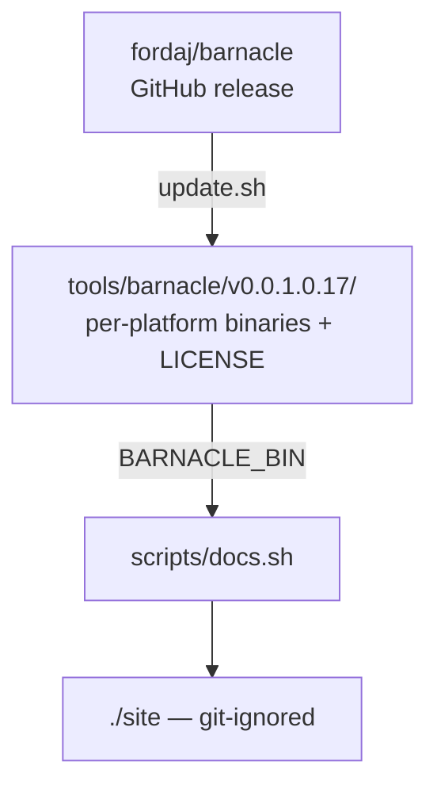

# The barnacle bundle (`tools/barnacle/`)



[Barnacle](https://github.com/fordaj/barnacle) is a documentation-site generator: it renders the `.md` and `.mmd` files scattered through a repository into a static, navigable HTML site. Formattington uses it to render _this_ documentation; the site you may be reading was built by it.

## Layout

```text
tools/barnacle/
  update.sh                     # refresh from fordaj/barnacle releases
  v0.0.1.0.17/
    macos-arm64/barnacle
    macos-arm64/LICENSE           # upstream MIT text, retained unmodified
    macos-x86_64/barnacle
    macos-x86_64/LICENSE
    linux-arm64/barnacle
    linux-arm64/LICENSE
    linux-x86_64/barnacle
    linux-x86_64/LICENSE
    windows-arm64/barnacle.exe
    windows-arm64/LICENSE
    windows-x86_64/barnacle.exe
    windows-x86_64/LICENSE
```

## `update.sh` in detail

Adapted to barnacle's release format (unlike the `.7z` bundles elsewhere in `tools/`): assets are `barnacle-<platform>.tar.gz` (macOS/Linux) and `barnacle-<platform>.zip` (Windows), each carrying a top-level `barnacle-<platform>/` directory with the binary, `LICENSE`, and `README.md`.

The script:

1. Resolves the tag (latest release, or `--tag vX.Y.Z...`), validating the tag shape.
2. Downloads via `gh`, then verifies every archive against the upstream `checksums.txt` (`shasum -a 256 -c` or `sha256sum -c`). A mismatch is fatal.
3. Extracts each archive (`tar` for `.tar.gz`; `unzip`, falling back to `7z`/`7zz` for `.zip`), copies the binary into `v<tag>/<platform>/`, and makes it executable.
4. Copies each archive's `LICENSE` (archive root or one level down, like the binary) into the platform directory.
5. Swaps in the new version directory and deletes superseded ones, then smoke-tests the host binary (`barnacle --version`).

Licenses: MIT — see `v0.0.1.0.17/<platform>/LICENSE`. Environment overrides: `BARNACLE_REPO`, `BARNACLE_TAG`. `--dry-run` lists assets without touching anything.

## How the repository uses it

[scripts/docs.sh](../../scripts/docs.sh.md) resolves `BARNACLE_BIN` through the [env cascade](../../scripts/env.sh.md) and generates `./site/` from the repo root; the output is git-ignored.

## Related pages

- [../README.md](../README.md) — the bundle index
- [../../scripts/README.md](../../scripts/README.md) — the scripts that consume the bundle
