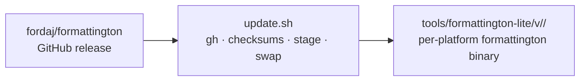

# The formattington-lite bundle (`tools/formattington-lite/`)

[Formattington](https://github.com/fordaj/formattington) is this project. This bundle refreshes the **lite** release binaries — the binaries without the embedded formatter payload — from `fordaj/formattington` releases, the same way the other `tools/` bundles refresh their upstreams.

Unlike `versioner`, `logamuffin`, `runner-spawner`, and `barnacle`, this bundle is not wired into `scripts/.common.env` / the `*_BIN` cascade, and no pinned version directory is tracked right now. It exists so a released lite binary can be staged locally for comparison against a build from source.

## `update.sh`

Refreshes from `fordaj/formattington` releases: assets named `formattington-<platform>-lite.tar.gz`/`.zip` are mapped onto the bundle layout (e.g. `darwin-amd64` → `macos-x86_64`), verified against the release's checksums when present, staged into a temporary directory, and swapped in atomically; superseded version folders are deleted only after the new one is staged. Only the binary is kept, plus `NOTICE.md` and `LICENSES/`. `--dry-run` lists the planned changes without touching anything; `--tag` pins a specific release. Environment overrides: `FORMATTINGTON_REPO`, `FORMATTINGTON_TAG`.

See [../README.md](../README.md) for the shared bundle contract.

## Related pages

- [../README.md](../README.md) — the bundle index
- [../../scripts/release.sh.md](../../scripts/release.sh.md) — the release pipeline that produces the lite archives
