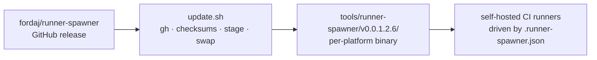

# The runner-spawner bundle (`tools/runner-spawner/`)



[Runner-spawner](https://github.com/fordaj/runner-spawner) manages self-hosted GitHub Actions runners. In this repository it drives the planned self-hosted CI on macOS and Windows runners (see [README.md — Continuous integration](../../README.md)); it operates on the committed `.runner-spawner.json`:

```json
{
  "owner": "fordaj",
  "repo": "formattington",
  "runnerNames": ["runner01"],
  "runnersDir": ".runners",
  "runnerGroup": "Default",
  "runnerVersion": "2.338.2"
}
```

The runner tree itself (`.runners/`) is machine-local state and is not committed.

## Bundled platforms

`v0.0.1.0.4/macos-arm64`, `macos-x86_64`, `linux-arm64`, `linux-x86_64`, `windows-arm64`, `windows-x86_64`. Note: runner-spawner reports unsupported on Linux (macOS + Windows only); the Linux binaries are shipped for uniform bundle layout, and the platform env files carry this caveat.

The pinned binary selection goes through the [env cascade](../../scripts/env.sh.md) (`RUNNER_SPAWNER_BIN`); `RUNNER_SPAWNER_REPO` is intentionally **not** the upstream — the scripts set `RUNNER_SPAWNER_TOOL_REPO=fordaj/runner-spawner` for the bundle refresh instead.

## `update.sh`

Refreshes from `fordaj/runner-spawner` releases: assets named `RunnerSpawner_<tag>_<os>-<arch>.tar.gz`/`.zip` (legacy `.7z` accepted) mapped onto the bundle layout. Verification is mandatory: a release with no `checksums.txt` aborts the refresh. Only the binary is kept. See [../README.md](../README.md) for the shared bundle contract (`--dry-run`, `--tag`, staged atomic swap).

## Related pages

- [../README.md](../README.md) — the bundle index
- [../../scripts/env.sh.md](../../scripts/env.sh.md) — the cascade selecting `RUNNER_SPAWNER_BIN`
