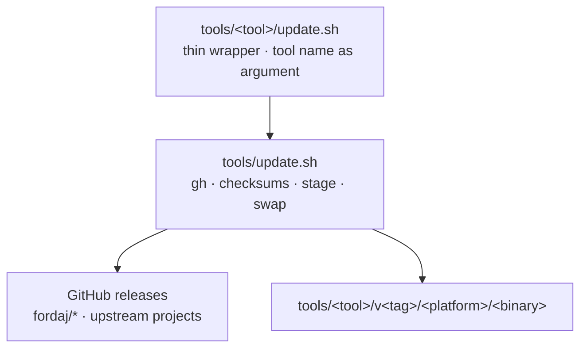

# The shared tool refresh (`tools/update.sh`)



`tools/update.sh` is the shared implementation behind every bundled helper
tool's refresh script — the per-tool `tools/<tool>/update.sh` files are thin
wrappers that pass their tool name as the first argument, so the refresh
logic (download, checksum verification, extraction, atomic swap, old
version cleanup) lives in exactly one audited place.

## Usage

```bash
tools/update.sh barnacle --dry-run   # resolve tag + list assets, change nothing
tools/update.sh barnacle             # download latest, replace old versions
tools/update.sh versioner --tag v0.0.3.0.5
tools/update.sh --help               # list the supported tools
```

Prefer the per-tool wrappers ([barnacle](barnacle/update.sh.md),
[formattington-lite](formattington-lite/update.sh.md),
[logamuffin](logamuffin/update.sh.md),
[runner-spawner](runner-spawner/update.sh.md),
[versioner](versioner/update.sh.md)), which encode each tool's defaults.

## What is parameterised per tool

| Tool                                                  | Default repo             | Binary           | Asset suffix filter | Checksums required | Extra files kept                |
| ----------------------------------------------------- | ------------------------ | ---------------- | ------------------- | ------------------ | ------------------------------- |
| [barnacle](barnacle/update.sh.md)                     | fordaj/barnacle          | barnacle         | —                   | no (warn)          | upstream MIT `LICENSE`          |
| [formattington-lite](formattington-lite/update.sh.md) | fordaj/formattington     | formattington    | `-lite`             | no (warn)          | `NOTICE.md` and `LICENSES/`     |
| [logamuffin](logamuffin/update.sh.md)                 | fordaj/logamuffin        | logamuffin       | —                   | no (warn)          | —                               |
| [runner-spawner](runner-spawner/update.sh.md)         | fordaj/runner-spawner    | runner-spawner   | —                   | **yes** (refuses)  | —                               |
| [versioner](versioner/update.sh.md)                   | fordaj/Versioner         | versioner        | —                   | no (warn)          | —                               |

Each tool also keeps its own environment overrides for the repository slug
and pinned tag (e.g. `BARNACLE_REPO`/`BARNACLE_TAG`,
`RUNNER_SPAWNER_TOOL_REPO`/`RUNNER_SPAWNER_TAG`,
`FORMATTINGTON_REPO`/`FORMATTINGTON_TAG`), overridden by `--repo`/`--tag`.

## Shared pipeline

1. Resolve the tag (`gh release view`, or `--tag` / the environment
   override), refusing anything that does not match `vX.Y.Z...`.
2. `gh release download` every `.tar.gz`/`.zip`/`.7z` asset plus
   `checksums.txt`/`SHA256SUMS.txt` when present.
3. Map each archive's stem onto the bundle layout
   (`darwin-*/macos-*` → `macos-*`, `linux-*` → `linux-*`,
   `windows-*` → `windows-*`, `x64`/`amd64` → `x86_64`); the formattington-lite
   filter drops non-`-lite` assets.
4. Verify SHA256 checksums for the downloaded archives (fatal for
   runner-spawner, a warning for the others).
5. Extract to a staging directory, keeping only the binary (plus the
   tool's extra files), swap it into `tools/<tool>/v<tag>/`, and only then
   delete superseded `v*/` folders — a failed refresh leaves the previous
   bundle intact. The binary and the extra files are searched at the
   archive root and one level down, so archives that nest everything
   under a single top-level directory work unchanged.
6. Best-effort host verification: run the host's freshly installed binary
   with `--version` and warn when the output does not mention the tag.

`--dry-run` stops after step 2, printing the planned mapping without
changing anything.

## Related pages

- [README.md — the bundles index](README.md)
- [scripts/entry.sh.md](../../scripts/entry.sh.md) — the `log()` wrapper this script uses
