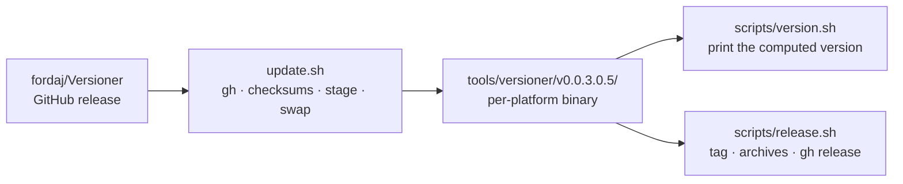

# The versioner bundle (`tools/versioner/`)

[Versioner](https://github.com/fordaj/Versioner) computes the version of this repository from its Git history, under the rules in `.versioner.json` (`defaultBranchVersion: 254`, `exemptBranches: { main: 0 }`, `tagPattern: v[0-9]*`). The release pipeline asks versioner for the next version, stamps it into every cross-compiled binary, tags the commit, and creates the GitHub release.

The pinned binary selection goes through the [env cascade](../../scripts/env.sh.md) (`VERSIONER_VERSION_DIR`/`VERSIONER_BIN`); `scripts/version.sh` prints what it computes, and [internal/formattington/version.go](../../internal/formattington/version.go.md) uses the same computation (or the stamp it produces) so `formattington --version` agrees with the tag.

## Bundled platforms

`v0.0.3.0.5/macos-arm64`, `macos-x86_64`, `linux-arm64`, `linux-x86_64`, `windows-x86_64`. There is **no windows-arm64 bundle upstream** — the windows-arm64 platform file points `VERSIONER_BIN` at a path that does not exist; set `VERSIONER_BIN` to a versioner on PATH if you need it there.

## `update.sh`

Refreshes from `fordaj/Versioner` releases: assets named `Versioner_<tag>_<os>-<arch>.tar.gz`/`.zip` (legacy `.7z` accepted), mapped onto the bundle layout (e.g. `darwin-amd64` → `macos-x86_64`), verified against the release's `checksums.txt` when present. Only the binary is kept; docs are discarded. See [../update.sh.md](../update.sh.md) for the shared refresh implementation (`--dry-run`/`--tag` usage) and [../README.md](../README.md) for the bundle contract.

## Related pages

- [../README.md](../README.md) — the bundle index
- [../../scripts/version.sh.md](../../scripts/version.sh.md)
- [../../scripts/release.sh.md](../../scripts/release.sh.md)
